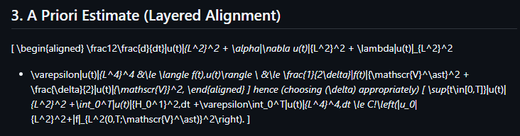
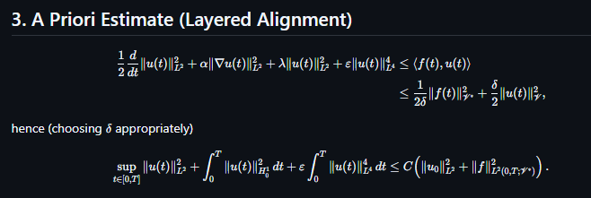

# GitHub Better LaTeX

A Chromium and Firefox extension that improves LaTeX rendering on GitHub.

## Before And After

**Before:** GitHub Copilot's original rendering.



**After:** With GitHub Better LaTeX enabled.



## Features

- Re-renders repository Markdown blob pages ending in `.md`, using the original
  Markdown source and KaTeX.
- Repairs failed display-math blocks in Copilot Chat when GitHub's error
  fallback still contains the original TeX source.
- Re-renders Copilot message bodies from original Markdown when it is available
  in the message's React props.

Markdown math supports `$...$` and `\(...\)` for inline expressions, and
`$$...$$` and `\[...\]` for display expressions. Copilot message controls are
preserved; GitHub-specific body widgets appear as standard Markdown output.

## Install

### Chromium

Build the unpacked extension:

```sh
pnpm install
pnpm build
```

Then open `chrome://extensions`, enable **Developer mode**, select **Load
unpacked**, and choose the generated `dist/` directory. After rebuilding,
reload the extension from the extensions page and refresh GitHub.

### Firefox

Firefox 140 or newer is required (142+ on Android). Build the Firefox version:

```sh
pnpm install
pnpm build:firefox
```

Open `about:debugging#/runtime/this-firefox`, select **Load Temporary Add-on**,
and choose `dist/firefox/manifest.json`. Reload the add-on there after rebuilding,
then refresh GitHub. Temporary add-ons are removed when Firefox restarts;
permanent installation in standard Firefox requires a Mozilla-signed package.

## Documentation

- [Architecture](docs/architecture.md): page handling, data flow, permissions,
  and security boundaries.
- [Development](docs/development.md): prerequisites, build commands, and manual
  smoke checks.

## Scope

Repository rendering currently targets GitHub blob URLs with a `.md` file on a
single-segment branch name. Copilot source access relies on private React
internals that may change. If the expected
assistant-message props are absent, the message body is left unchanged; failed
display math can still be repaired from GitHub's `<pre>` fallback.
